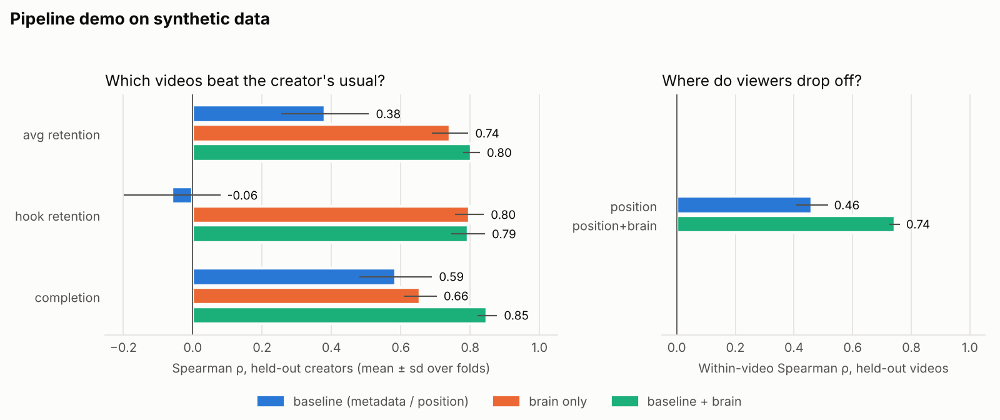
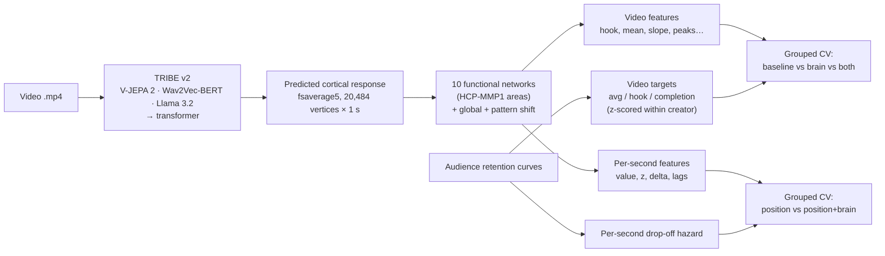

# neuro-engagement-forecasting

**Can a model of the human brain tell you which short-form videos will hold attention, and the exact second viewers will leave?**

This project uses [TRIBE v2](https://github.com/facebookresearch/tribev2), Meta FAIR's open brain-encoding model, to turn any video into a *predicted* second-by-second cortical response. It then tests whether that predicted brain activity forecasts real audience behaviour (watch time, hook retention, completion, per-second drop-off) **beyond what simple baselines already capture**.

The idea comes from *neuroforecasting*: brain activity measured in a small group of people can predict how a much larger population behaves. Tong et al. (2020, *PNAS*) found that reward-related (nucleus accumbens) and aversion-related (anterior insula) responses to YouTube videos forecast their real view counts and watch time better than people's own ratings did. Running that kind of study takes an fMRI scanner. TRIBE v2 makes it possible to approximate the brain-response step *in silico*, for any video, at no scanning cost. This repo provides the pipeline to check whether that approximation is actually useful.



> The figure above is from **synthetic data** with a planted signal (`neuroengage demo`). It shows the evaluation pipeline works end to end and recovers a known effect. It is **not** a result about real videos. A matching null run (`neuroengage demo --null`) confirms that the brain features add nothing when no signal is planted.

---

## How it works



1. **Extract** (`neuroengage extract`): run TRIBE v2 on each video. TRIBE outputs one prediction per second, already shifted 5 s to undo hemodynamic lag, so row *t* lines up with second *t* of the video.
2. **Summarize** into networks (`neuroengage.rois`). Single vertices are noisy and hard to interpret, so they are averaged into networks the literature ties to attention and valuation:

   | Network | HCP-MMP1 areas (examples) | Why it's here |
   |---|---|---|
   | `valuation_mpfc` | 10r, 10v, OFC, 25, s32 | Valuation. Cortical stand-in for ventral-striatum "reward" signals |
   | `salience_insula` | AAIC, AVI, MI, FOP4/5 | Anterior insula forecasts aversion and skipping (Tong et al., 2020) |
   | `dorsal_attention` | FEF, LIP, IPS1, 7PC | Sustained, goal-directed attention |
   | `ventral_attention` | PGi, PFm, PF, STV | Reorienting to surprising or salient events |
   | `default_mode` | 7m, 31pv, v23ab, RSC | Rises when attention drifts (mind-wandering) |
   | `visual_early`, `visual_motion`, `face_body`, `auditory`, `language` | V1–V4, MT, FFC, A1, STS, 44/45 … | Sensory and narrative drive |

   Two composite signals: **`affect_balance`** = valuation − insula ("rewarding and not aversive"), and **`attention_index`** = dorsal attention − default mode (focused versus drifting). **`pattern_shift`** is 1 − the correlation between consecutive whole-cortex patterns, which spikes at event boundaries such as cuts, reveals and topic changes.
3. **Featurize** (`neuroengage.features`) at two levels:
   - *video level*: per signal, the mean, variability, first-3-second "hook" value, hook versus rest, trend, late versus early, and peak timing;
   - *second level*: per signal, the raw value, within-video z-score, change from the previous second, rolling mean, and lags.
4. **Evaluate** (`neuroengage.modeling`). Every comparison runs on identical folds:
   - **Video level** (ridge regression): `baseline` (duration and metadata) vs `brain` vs `baseline+brain`. Folds hold out **whole creators**. Targets are z-scored **within creator**, because raw views mostly measure audience size. The question becomes "is this video better than this creator's usual?", which is what a content decision can actually change.
   - **Drop-off** (gradient boosting): `position` (seconds into the video) vs `position+brain`. Folds hold out **whole videos**. The metric is within-video rank correlation between predicted and actual drop-off, excluding the first 3 s, since every video loses most viewers at the start.
5. **Score** new drafts (`neuroengage score`): get a predicted relative-retention score per video and a per-second drop-off risk curve, so you can see *where* a draft is likely to lose people.

## Quickstart (no GPU needed)

```bash
git clone https://github.com/RehanKrish21/neuro-engagement-forecasting.git
cd neuro-engagement-forecasting
pip install -e ".[test]"
pytest -q                                 # 17 tests
neuroengage demo --out results/demo       # synthetic data with planted signal
neuroengage demo --null --out results/null  # control: no signal → no gain
```

Each run writes `report.md`, `summary.png`, metrics CSVs, out-of-fold predictions and fitted models to the output folder.

## Running on real videos

**1. Install TRIBE v2.** It needs a GPU, Python ≥ 3.11, and approved access to [`meta-llama/Llama-3.2-3B`](https://huggingface.co/meta-llama/Llama-3.2-3B) on Hugging Face.

```bash
git clone https://github.com/facebookresearch/tribev2 && pip install -e "tribev2[plotting]"
huggingface-cli login
```

**2. Prepare two CSVs** (see `examples/`):

- `videos.csv`: `video_id, creator_id, path, duration_s` plus any baseline columns (`log_followers`, `post_hour`, …)
- `retention.csv`: `video_id, t, retention`, the fraction of starting viewers still watching at second `t`. For YouTube, the Analytics API audience-retention report (`elapsedVideoTimeRatio`, `audienceWatchRatio`) converts with `neuroengage.retention.from_youtube`. Curves are interpolated onto 1-second steps and forced to never increase.

**3. Run:**

```bash
neuroengage extract --manifest videos.csv --out work
neuroengage train --manifest videos.csv --timeseries work/network_timeseries \
    --retention retention.csv --baseline-cols duration_s,log_followers,post_hour --out results/run
neuroengage score --models results/run/models.joblib --timeseries work_new/network_timeseries \
    --manifest new_videos.csv --out results/scores
```

A few hundred videos across several creators is the minimum for the video-level comparison to say anything. The per-second model gets far more rows per video, so it becomes informative sooner.

## What would count as a real result

- `baseline+brain` beats `baseline` on held-out creators, in most folds, by a margin larger than the fold-to-fold spread.
- `position+brain` beats `position` for per-second drop-off.
- The gain holds against a **stronger baseline**: the raw V-JEPA 2 / Wav2Vec-BERT / Llama embeddings TRIBE is built on. Add them as baseline columns. If the brain-network layer doesn't beat its own inputs, the "brain" framing isn't adding predictive value (it may still add interpretability).
- The same analysis run with `--null`-style shuffled targets shows no gain.

## Limitations (please read)

- **This does not measure dopamine.** fMRI measures blood-oxygen (BOLD) signals, not neurotransmitters. TRIBE v2's released weights cover **cortex only**, while the ventral striatum and midbrain, where reward-prediction signals live, are subcortical. The `valuation_mpfc` network is a cortical proxy for valuation, not a dopamine readout. The TRIBE repo includes a subcortical training grid (`tribev2.grids.run_subcortical`), which is the natural next step.
- **Average brain, average viewer.** TRIBE predicts the response of an average participant from its training cohorts. Your audience may differ.
- **Predicted, not measured.** Errors in TRIBE's predictions carry straight into the features. Treat everything here as a hypothesis generator until it is validated on real outcomes.
- **Correlational.** A feature that predicts retention is not necessarily a lever you can pull.
- **License.** This repository's code is MIT. TRIBE v2 is **CC BY-NC 4.0 (non-commercial)** and is not bundled here. Llama 3.2 has its own license. Commercial use of TRIBE-derived outputs needs permission from Meta.

## Roadmap

- [ ] Run on a real channel's back catalogue with YouTube Analytics retention curves
- [ ] Add raw-embedding baselines (V-JEPA 2, Wav2Vec-BERT, Llama 3.2) as a built-in feature set
- [ ] Train a subcortical (ventral striatum) readout with `tribev2.grids.run_subcortical`
- [ ] Multi-task fine-tune: engagement head on TRIBE's latent space, keeping the brain-prediction loss as a regularizer
- [ ] Per-second "drop-off risk" visualizer synced to video playback

## Project layout

```
src/neuroengage/
  tribe_runner.py   TRIBE v2 wrapper: video → per-second cortical predictions (cached .npz)
  rois.py           HCP-MMP1 network definitions, network time series, pattern shift
  features.py       video-level and per-second features, composite signals
  retention.py      retention curves → per-second hazard and video targets
  modeling.py       grouped CV, creator normalization, feature-set comparison
  pipeline.py       end-to-end train/evaluate → report.md + figure + models
  synthetic.py      planted-signal and null synthetic data for demos/tests
  cli.py            neuroengage {demo, extract, train, score}
tests/              17 tests, including signal-recovery and null-control checks
```

## References

- d'Ascoli, S. et al. (2026). *A foundation model of vision, audition, and language for in-silico neuroscience* (TRIBE v2). arXiv:2605.04326. Code: [facebookresearch/tribev2](https://github.com/facebookresearch/tribev2)
- d'Ascoli, S. et al. (2025). *TRIBE: TRImodal Brain Encoder for whole-brain fMRI response prediction*. [arXiv:2507.22229](https://arxiv.org/abs/2507.22229). 1st place, Algonauts 2025.
- Tong, L. C., Acikalin, M. Y., Genevsky, A., Shiv, B., & Knutson, B. (2020). Brain activity forecasts video engagement in an internet attention market. *PNAS*, 117(12), 6936–6941.
- Knutson, B., & Genevsky, A. (2018). Neuroforecasting aggregate choice. *Current Directions in Psychological Science*, 27(2), 110–115.
- Dmochowski, J. P. et al. (2014). Audience preferences are predicted by temporal reliability of neural processing. *Nature Communications*, 5, 4567.
- Falk, E. B., Berkman, E. T., & Lieberman, M. D. (2012). From neural responses to population behavior: neural focus group predicts population-level media effects. *Psychological Science*, 23(5), 439–445.
- Glasser, M. F. et al. (2016). A multi-modal parcellation of human cerebral cortex. *Nature*, 536, 171–178.
