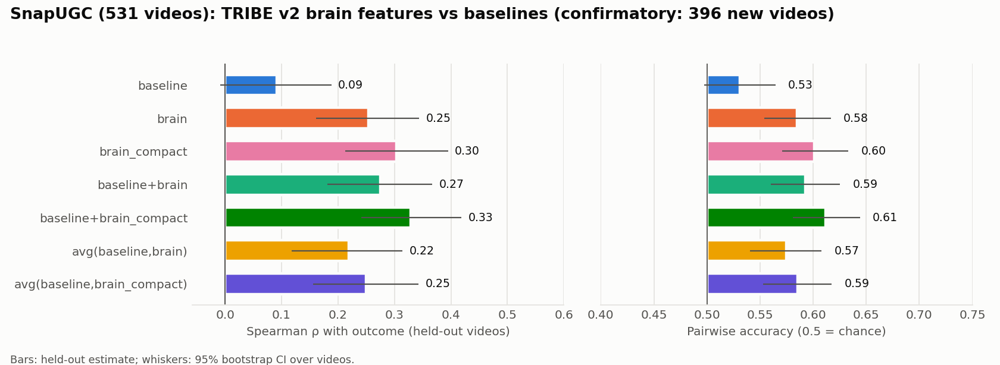
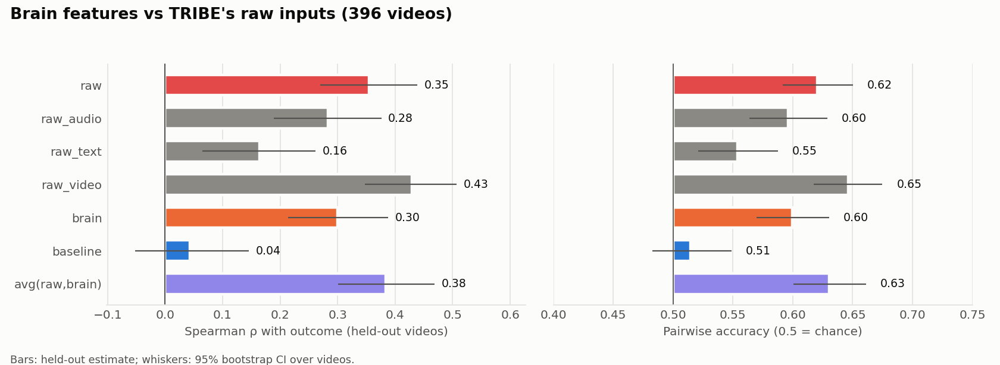

# SnapUGC (531 videos): TRIBE v2 brain features vs baselines

531 videos, 5-fold cross-validation, shuffled K-fold over videos (no creator IDs). Baseline: `duration_s`, `title_n_words`, `has_description`.

## Held-out performance (pooled out-of-fold, 95% bootstrap CIs)

Pre-registered primary comparison: **avg(baseline,brain) vs baseline** (docs/preregistration.md). `pairwise_acc` = share of video pairs ranked in the right order (0.5 = chance). `brain_compact` = only the `mean` and `hook` statistics of each brain signal; `avg(a,b)` = fixed 50/50 average of the two models' ranks (nothing fitted). Gains are paired (same bootstrap resamples). When present, the **confirmatory** rows exclude the videos used to choose this analysis (run 1) and are the ones that test it.

| subset | target | feature_set | spearman | 95% CI | pairwise_acc | pairwise 95% CI | gain_vs_baseline | gain 95% CI | P(gain>0) |
|---|---|---|---|---|---|---|---|---|---|
| all videos | ecr | baseline | 0.152 | [0.06, 0.24] | 0.551 | [0.52, 0.58] | 0.000 | [0.00, 0.00] | 0.000 |
| all videos | ecr | brain | 0.246 | [0.16, 0.32] | 0.582 | [0.55, 0.61] | 0.094 | [-0.01, 0.19] | 0.970 |
| all videos | ecr | brain_compact | 0.287 | [0.21, 0.36] | 0.596 | [0.57, 0.62] | 0.135 | [0.03, 0.24] | 0.990 |
| all videos | ecr | baseline+brain | 0.275 | [0.19, 0.35] | 0.592 | [0.56, 0.62] | 0.123 | [0.03, 0.21] | 1.000 |
| all videos | ecr | baseline+brain_compact | 0.320 | [0.24, 0.40] | 0.608 | [0.58, 0.63] | 0.168 | [0.08, 0.25] | 1.000 |
| all videos | ecr | **avg(baseline,brain)** (primary) | 0.253 | [0.17, 0.33] | 0.586 | [0.56, 0.61] | 0.101 | [0.05, 0.15] | 1.000 |
| all videos | ecr | avg(baseline,brain_compact) | 0.281 | [0.20, 0.36] | 0.595 | [0.57, 0.62] | 0.129 | [0.07, 0.18] | 1.000 |
| confirmatory: 396 new videos | ecr | baseline | 0.091 | [-0.01, 0.19] | 0.531 | [0.50, 0.56] | 0.000 | [0.00, 0.00] | 0.000 |
| confirmatory: 396 new videos | ecr | brain | 0.253 | [0.16, 0.34] | 0.585 | [0.55, 0.62] | 0.162 | [0.05, 0.28] | 1.000 |
| confirmatory: 396 new videos | ecr | brain_compact | 0.303 | [0.21, 0.39] | 0.601 | [0.57, 0.63] | 0.212 | [0.09, 0.33] | 1.000 |
| confirmatory: 396 new videos | ecr | baseline+brain | 0.275 | [0.18, 0.37] | 0.592 | [0.56, 0.63] | 0.183 | [0.08, 0.29] | 1.000 |
| confirmatory: 396 new videos | ecr | baseline+brain_compact | 0.329 | [0.24, 0.42] | 0.611 | [0.58, 0.64] | 0.237 | [0.13, 0.34] | 1.000 |
| confirmatory: 396 new videos | ecr | **avg(baseline,brain)** (primary) | 0.219 | [0.12, 0.31] | 0.575 | [0.54, 0.61] | 0.128 | [0.06, 0.19] | 1.000 |
| confirmatory: 396 new videos | ecr | avg(baseline,brain_compact) | 0.249 | [0.16, 0.34] | 0.585 | [0.55, 0.62] | 0.158 | [0.09, 0.22] | 1.000 |

### Per-fold detail

| target | feature_set | spearman_mean | spearman_std | r2_mean | spearman_gain_vs_baseline | folds_better_than_baseline |
|---|---|---|---|---|---|---|
| ecr | baseline | 0.184 | 0.054 | 0.012 | 0.000 | 0.000 |
| ecr | brain | 0.252 | 0.091 | 0.062 | 0.068 | 0.800 |
| ecr | brain_compact | 0.296 | 0.113 | 0.077 | 0.111 | 0.800 |
| ecr | baseline+brain | 0.277 | 0.064 | 0.074 | 0.092 | 0.800 |
| ecr | baseline+brain_compact | 0.326 | 0.081 | 0.095 | 0.141 | 1.000 |
| ecr | avg(baseline,brain) | 0.272 | 0.061 | nan | 0.087 | 0.800 |
| ecr | avg(baseline,brain_compact) | 0.303 | 0.079 | nan | 0.119 | 1.000 |

## Raw-feature baseline (exploratory, added 2026-11-24)

396 videos with saved raw features. `raw` = the features TRIBE itself is built on (V-JEPA 2 video, Wav2Vec-BERT audio, Llama 3.2 text: whole-video and first-5-s averages; dimensions audio: 4097, text: 12289, video: 5633), fed to a ridge model with strong regularisation. Gains are relative to `raw`: does TRIBE's predicted brain activity add anything beyond its own inputs? Not part of the pre-registered primary test.

| target | feature_set | spearman | 95% CI | pairwise_acc | pairwise 95% CI | gain_vs_raw | gain 95% CI | P(gain>0) |
|---|---|---|---|---|---|---|---|---|
| ecr | raw | 0.355 | [0.27, 0.44] | 0.621 | [0.59, 0.65] | 0.000 | [0.00, 0.00] | 0.000 |
| ecr | raw_audio | 0.283 | [0.19, 0.38] | 0.596 | [0.56, 0.63] | -0.072 | [-0.15, 0.01] | 0.040 |
| ecr | raw_text | 0.164 | [0.07, 0.26] | 0.554 | [0.52, 0.59] | -0.191 | [-0.28, -0.10] | 0.000 |
| ecr | raw_video | 0.429 | [0.35, 0.51] | 0.646 | [0.62, 0.67] | 0.074 | [-0.01, 0.15] | 0.970 |
| ecr | brain | 0.300 | [0.21, 0.39] | 0.599 | [0.57, 0.63] | -0.055 | [-0.15, 0.04] | 0.140 |
| ecr | baseline | 0.043 | [-0.05, 0.15] | 0.515 | [0.48, 0.55] | -0.312 | [-0.44, -0.19] | 0.000 |
| ecr | avg(raw,brain) | 0.384 | [0.30, 0.47] | 0.630 | [0.60, 0.66] | 0.029 | [-0.02, 0.08] | 0.850 |

## Largest standardized coefficients: ecr (baseline+brain ridge)

| feature | std_coef |
|---|---|
| title_n_words | 0.022 |
| valuation_mpfc__std | 0.020 |
| valuation_mpfc__hook | -0.019 |
| valuation_mpfc__mean | -0.017 |
| pattern_shift__hook | -0.014 |
| duration_s | -0.014 |
| has_description | 0.013 |
| ventral_attention__mean | 0.012 |
| valuation_mpfc__peak_time_frac | 0.012 |
| salience_insula__peak_time_frac | 0.012 |
| default_mode__mean | 0.011 |
| pattern_shift__peak_time_frac | 0.011 |
